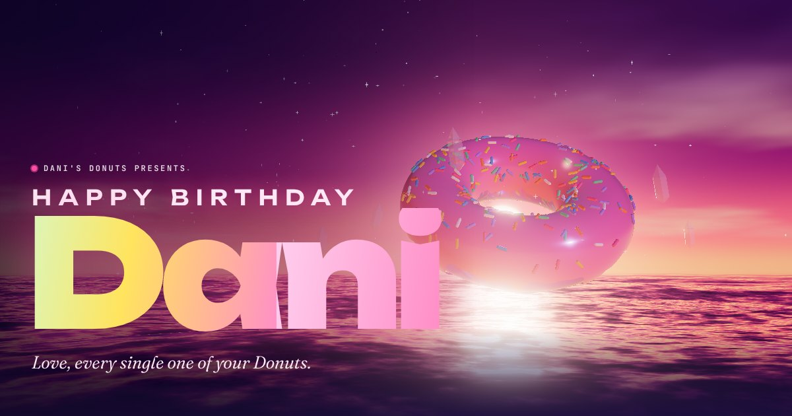

# 🍩 Dani's Donuts

**A love letter to HeyDani, built by her community.**

It's a community "card wall" in the spirit of Kudoboard, rebuilt as a small game. Every message becomes a one-of-a-kind holographic donut card. The page plays out over a Florida sunset that turns into a night sky as you scroll. At the end, every person who wrote in becomes a star in a heart-shaped constellation above the ocean.



---

## What's inside

| | |
|---|---|
| **Boot screen** | A game-style loading screen with tips, then **PRESS START**. That click also turns on the sound. |
| **01 · Lobby** | A real-time 3D scene: a crystal-glass donut with strawberry glaze and sprinkles, floating over a shader-rendered sunset ocean. The glass shows refraction, dispersion and iridescence. Drag to spin it; click to **boop** it. Boops count up in a shared global counter. The intro is a "dropping in" camera dive with an altitude readout. |
| **02 · Player One** | A character-select profile for Dani with animated stat bars ("Donut Capacity: 128!!") and a loadout with rarity tooltips. |
| **03 · The Donut Wall** | The heart of it. Every message is a **holographic collector card** with dripping frosting, its own card number, a sticker, and a **unique donut avatar generated from the writer's name**. Cards tilt with the mouse, and with the phone's gyroscope on mobile. Tap one to pull it out like a rare card: flip it, heart it, copy a deep link, or **save it as a 1080×1350 PNG** to post. Search, sort (newest / oldest / most loved / shuffle), photos-only filter. New messages appear **live**. |
| **Bake a message** | A composer with a **live preview** of your card: 11 frosting flavors, 12 die-cut stickers, an optional handwriting style, and a GIF link or photo upload. Photos are resized in the browser before upload. Drafts auto-save. |
| **04 · Season Pass** | "The Dani Era": a battle-pass track that pins and scrolls sideways. Each tier has a reward you can **claim**. |
| **05 · Collection** | **Seven crystals are hidden across the page**, each with a meaning. Find all seven to unlock the legendary **Donut Heart** and a secret message. |
| **06 · Arcade** | **Donut Drop: Beach Edition**, a full mini-game with a leaderboard. Catch donuts, grab crystals, dodge burnt donuts, and watch out for seagulls. Golden donuts trigger a 2× Sugar Rush, and 500+ points earns a crystal. |
| **07 · Live** | The Twitch player loads only when clicked (for privacy and speed), plus TikTok, Instagram and merch links. |
| **08 · For Dani** | Night falls. **Every message writer becomes a star** in a heart-shaped constellation; hover one to see who. Then a handwritten-style letter signed by everyone, and **"Make a wish"**: Dani can **blow into her microphone** (or hold a button) to blow out the candle and set off fireworks. |
| **Gamification** | XP, 10 donut ranks (Sprinkle → Legendary Donut), 14 trophies (including secret ones), a locker, and Xbox-style achievement pop-ups. |
| **Sound** | Everything is synthesized live in the browser (no audio files): ocean waves, a soft lo-fi pad, crystal chimes, UI blips. Sound has an on/off toggle. |
| **Easter eggs** | ↑ ↑ ↓ ↓ ← → ← → B A, and a night-owl trophy. |
| **Stream Mode** `/#/stream` | A full-screen, chat-readable slideshow for **the big reveal on stream**. It auto-advances based on message length. Keys: Space pause · ← → · S shuffle · F fullscreen · H hide controls. New messages slot in live with a "Just in!" badge. |
| **OBS overlay** `/#/overlay` | A transparent Browser Source that rotates messages on screen while she streams. |
| **Organizers** `/#/admin` | A moderation queue: approve, hide or delete. |

It also handles accessibility and performance: it respects reduced motion, is keyboard-friendly with screen-reader labels, traps focus inside dialogs, and falls back to a 2D lobby when WebGL isn't available. It lowers 3D quality on weaker devices, pauses animations that are off-screen, loads the 3D engine and database code only when needed, and works on phones.

---

## 1 · Try it locally (2 minutes)

You need [Node.js](https://nodejs.org) 20+.

```bash
npm install
npm run dev
```

Open the address it prints. Without a database it runs in **Preview Mode**: you'll see sample messages (fictional, no real usernames), and anything you post is saved only in your browser. A small **PREVIEW** chip in the top bar tells you you're in this mode.

## 2 · Make it yours

**Everything personal is in [`src/config.ts`](src/config.ts).** No coding needed.

- `occasion`: switch between birthday, anniversary or celebration and change the headline. Set `date: '2026-12-14'` to show a live countdown.
- `letter`: the letter at the end. **Please read it and make it yours.**
- `seasonPass`: the tiers. Swap in real milestones (first stream, affiliate, partner, a legendary raid…) with dates.
- `profile`: the playful Player One stats.
- `secretMessage`: what people see when they find all seven crystals.
- `streamer.photo`: put a photo in `public/` (for example `public/dani.jpg`) and set `photo: 'dani.jpg'`.
- `siteUrl`: your final address, shown in Stream Mode so chat knows where to go.

## 3 · Go live: a shared wall for everyone (free)

1. Create a free project at [supabase.com](https://supabase.com).
2. In **SQL Editor → New query**, paste all of [`supabase/schema.sql`](supabase/schema.sql) and click **Run**.
3. Create your organizer login: **Authentication → Users → Add user** (email + password, "auto confirm"). Then in the SQL editor run:
   ```sql
   insert into public.organizers (email) values ('you@example.com');
   ```
4. Copy **Project URL** and the **anon public key** from **Project Settings → API**, then either:
   - create a `.env` file (see [`.env.example`](.env.example)) for local dev, **or**
   - add them as GitHub **Actions variables** named `VITE_SUPABASE_URL` and `VITE_SUPABASE_ANON_KEY` (Settings → Secrets and variables → Actions → Variables).

   The anon key is designed to be public. Row Level Security in the schema is what protects the data.

**Moderation:** by default every new message waits for approval at **`/#/admin`**. The writer still sees their own card marked "in the oven". To skip approval, change one line in `schema.sql` (`new.approved := true;`) and set `supabase.autoApprove: true` in the config.

## 4 · Deploy

**GitHub Pages (already set up):** merge to `main`, then go to **Settings → Pages → Source: GitHub Actions**. Every push to `main` builds and deploys automatically with [`.github/workflows/deploy.yml`](.github/workflows/deploy.yml).

**Netlify / Vercel / Cloudflare Pages:** build command `npm run build`, output folder `dist`, plus the two environment variables. The build uses relative paths, so it works from any URL or sub-folder.

> For the nicest link previews on Discord/Twitter, change `og:image` in `index.html` to a full URL, for example `https://your-site/og.jpg`.

## 5 · The big reveal: a checklist

- [ ] Read and personalize the letter in `src/config.ts`.
- [ ] Set the `date` for the countdown and `siteUrl` for Stream Mode.
- [ ] Connect Supabase and deploy. Sample messages disappear automatically once the live wall is connected.
- [ ] Share the link with chat and the mods. Approve messages at `/#/admin` as they come in.
- [ ] On the day: open **`/#/stream`**, press **F** for fullscreen, share that window on stream, and press **Space**.
- [ ] Let Dani scroll to the end and blow out the candle. 🎂

**OBS overlay:** add a *Browser Source* with the URL `https://your-site/#/overlay?every=25&pos=bl&scale=1` (pos: `bl`, `br`, `tl`, `tr`). Its background is transparent.

## Where the crystals are (spoilers, organizers only)

<details><summary>Show me</summary>

1. **Citrine**: in the Lobby, a little glint near the horizon on the right.
2. **Clear Quartz**: the last loadout slot in Player One.
3. **Rose Quartz**: next to the message counter on the Donut Wall.
4. **Amethyst**: on the "Crystal Clear" Season Pass tier.
5. **Opal**: earned by scoring 500+ in Donut Drop.
6. **Aquamarine**: in the waves at the bottom of the Live section.
7. **Moonstone**: click the moon in the night sky.

The crystals orbiting the 3D donut light up as you find them. Clicking an unfound one gives a hint.
</details>

---

## Tech

Vite + TypeScript with no UI framework. Three.js renders the lobby with custom GLSL for the sky and ocean, a transmission/iridescence/dispersion glass material, instanced sprinkles, and bloom. Everything else is hand-built: Canvas 2D for the game, constellation and confetti; procedural SVG for the donut avatars, stickers and faceted crystals; Web Audio for every sound; and Supabase (Postgres, Row Level Security, Realtime, Storage) for the shared wall. Fonts are self-hosted: Unbounded, Fraunces, Plus Jakarta Sans, JetBrains Mono and Caveat.

```
src/
  config.ts            ← everything personal
  main.ts              boot screen, routing, easter eggs
  scene/heroScene.ts   the 3D lobby
  sections/            lobby, player, wall, pass, collection, arcade, live, finale
  components/          holo card, composer, inspector, HUD, art generators, confetti…
  views/               stream mode, OBS overlay, organizer dashboard
  data/                Preview Mode (localStorage) + Supabase stores
supabase/schema.sql    tables, security policies, realtime, storage
```

Made with love by Dani's Donuts. A fan-made community gift, not affiliated with any game, platform or brand mentioned.
